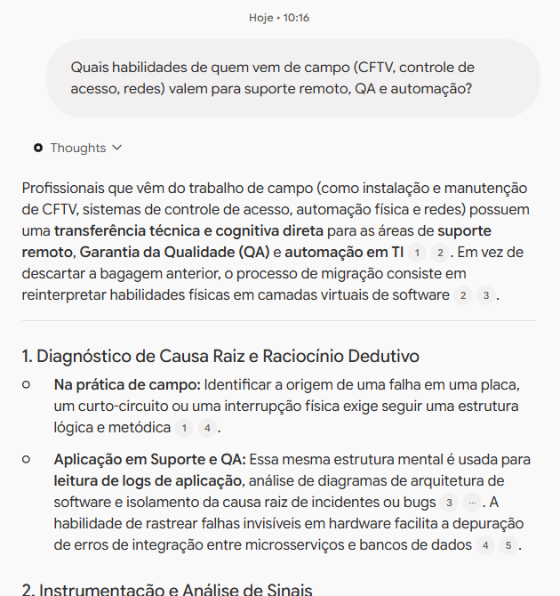
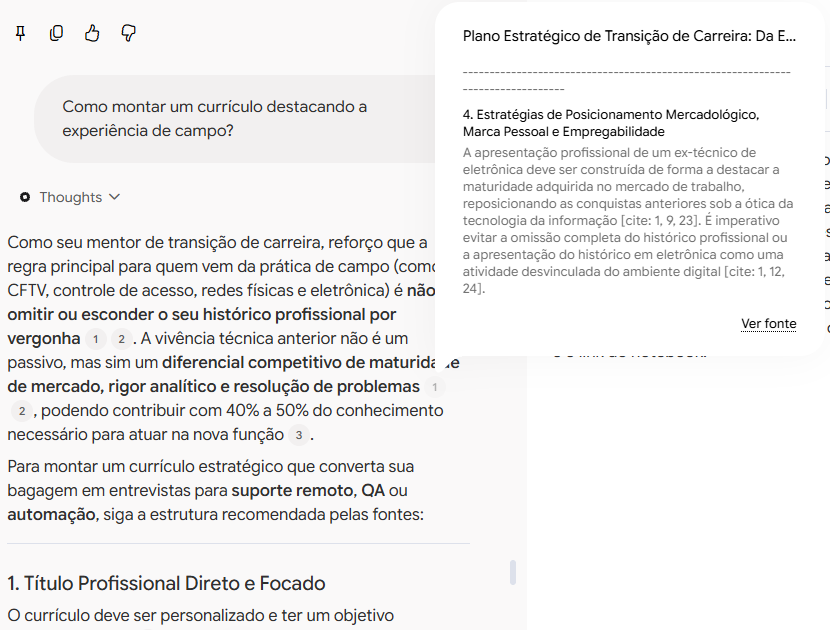
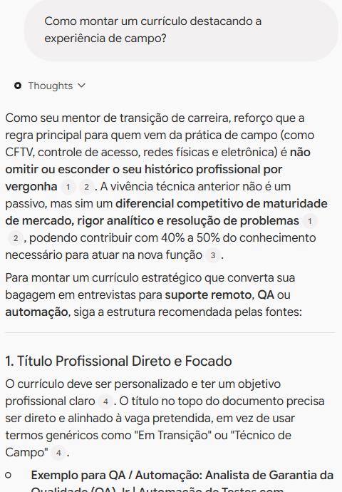

# Segundo cérebro: transição de carreira para TI

Projeto do desafio **Treinando uma IA de Aprendizagem: Explore o Poder do NotebookLM** (DIO, trilha Santander – Automação com n8n). Montei um notebook no Gemini Notebook (antigo NotebookLM) que estuda comigo o tema que escolhi, usando só as fontes que selecionei.

**Notebook compartilhado:** https://notebook.google.com/notebook/39a5d021-6b6e-4860-a821-e0cd69b859a2

## 1. Tema e objetivo

**Tema:** transição de carreira para a área de TI.

**Objetivo (uma frase):** ter um especialista que me ajude a ir de técnico de sistemas eletrônicos (CFTV, controle de acesso, redes) para suporte técnico, QA e automação, mostrando quais habilidades aproveitar, o que estudar e como me apresentar.

## 2. Fontes que entraram e por que confio nelas

Critérios para aceitar uma fonte: ser recente (2025/2026), ter autor ou instituição identificável e tratar do mercado de TI, de preferência o brasileiro. Usei formatos diferentes (artigos, vídeo, relatos de comunidade e um relatório de pesquisa) para cruzar visões.

**Carreira e transição para TI (artigos de empresas e escolas de tecnologia)**

- Como fazer transição de carreira pra TI? Etapas e estratégias – Hashtag Treinamentos
- Guia completo de como construir sua carreira na área de TI em 2026 – Alura
- Primeiro emprego em tecnologia: 12 passos para começar na área de TI – Serasa Experian
- Transição de carreira para a área de TI: por onde começar? – Vsoft
- Transição de carreira para TI: como começar e o que esperar – TI Especialistas
- Transição de carreira para TI: por onde começar? – CPET
- Transição de carreira para TI: redes, segurança, nuvem ou gestão? Por qual trilha começar?
- Transição de Carreira para Suporte de TI – Evo Tecnologia (Hotmart)
- O que é um especialista em suporte técnico? – ServiceNow

**Relatos de quem fez a mudança (experiência pessoal, usados como opinião e não como fato)**

- Vídeo no YouTube: De Suporte a QA – Como Guilherme mudou de carreira em 4 meses
- Reddit r/brdev: Carreira de suporte existe sim!!!
- Reddit r/brdev: Transição para Programação aos 24: suporte técnico há 6 anos. Por onde começar hoje?
- Reddit r/softwaretesting: Mudando de suporte técnico pra QA

**Certificação e fundamentos de QA**

- Certified Tester Foundation Level (CTFL) v4.0 Overview – ISTQB (fonte oficial da certificação)
- Materiais de preparação para o ISTQB CTFL v4.0 (Noble, Exactprep, ExamSnap, Nobleprog)

**Mercado e ferramentas de automação de testes (para entender o que as vagas pedem)**

- Playwright vs. Selenium in 2026 – Sauce Labs
- Cypress vs Selenium vs Playwright: Which in 2026? – Pie
- Selenium vs Playwright vs Cypress 2026: Honest Comparison – Crosscheck
- Top 7 Automated Software Testing Tools in 2026 – Nextage
- Top 10 Trending Automation Testing Tools in 2026 – QA Tech Xperts
- 10 Best Test Automation Companies in 2026 – TestDevLab
- QA Test Management Software: 2026 Buyer's Guide

**Relatório de pesquisa**

- Relatório do Deep Research do próprio Gemini Notebook: Plano Estratégico de Transição de Carreira – Da Eletrônica ao Suporte Técnico, Garantia da Qualidade (QA) e Automação em TI. Como foi gerado por IA, serve como ponto de partida e deve ser conferido nas outras fontes.

## 3. Diretriz de comportamento dada ao notebook

> Comporte-se como um mentor de carreira especializado em transição para TI. Responda só com base nas fontes e cite de onde veio cada ponto. Quando eu descrever minha experiência anterior, aponte quais habilidades são transferíveis e quais lacunas faltam fechar. Se as fontes não cobrirem o que perguntei, diga que não encontrou.

## 4. Perguntas, respostas e fontes

As respostas do notebook trazem números de citação clicáveis. Ao clicar, o notebook abre o trecho da fonte de onde a informação saiu.

### Pergunta 1: Quais habilidades de quem vem de campo (CFTV, controle de acesso, redes) valem para suporte remoto, QA e automação?

**Resposta (resumo):** a experiência de campo gera uma transferência técnica e cognitiva direta. Em vez de descartar a bagagem anterior, a migração consiste em reinterpretar habilidades físicas em camadas virtuais de software. Os pontos principais foram: (1) diagnóstico de causa raiz e raciocínio dedutivo, que vira leitura de logs e isolamento de bugs; (2) instrumentação e análise de sinais, como o uso de multímetros, osciloscópios e testadores de cabo.

**Fontes:** citações 1 a 6 no notebook. A citação 1 abre o relatório do Deep Research (segundo print).

### Pergunta 2: Como montar um currículo destacando a experiência de campo?

**Resposta (resumo):** posicionar o histórico de campo não como atraso, mas como diferencial de rigor analítico e resolução prática de problemas. O notebook sugeriu: (1) um título profissional direto e alinhado ao cargo-alvo, evitando termos genéricos como "Técnico de Campo"; (2) um resumo profissional que conecte a trajetória de campo às novas qualificações; (3) personalizar o currículo para cada vaga com as palavras-chave do anúncio.

**Fontes:** citações 1 a 4 no notebook.

## 5. Materiais gerados no Estúdio

- Mapa mental (PNG): pasta materiais, arquivo NotebookLM Mind Map.png
- Apresentação de slides Modern QA Blueprint 2026 (PDF): pasta materiais, arquivo Modern_QA_Blueprint_2026.pdf

## 6. Estrutura do repositório

- prints/: capturas do chat mostrando as respostas e as citações
- materiais/: arquivos baixados do Estúdio (mapa mental e slides)
